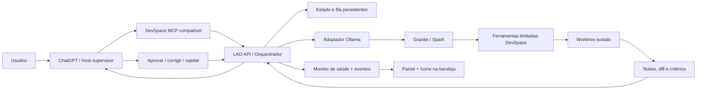

# LAO DevSpace — Roadmap de Produto e Engenharia
## Local Agent Orchestrator + DevSpace

**Versão do plano:** 1.0
**Situação:** planejamento aprovado conceitualmente; implementação pendente
**Repositório-alvo:** `alvarolordelo/devspace` (fork)
**Branch de desenvolvimento:** `feature/lao-devspace`
**Regra principal:** manter o DevSpace existente utilizável, sem alteração de comportamento quando o LAO estiver desativado.
**Ambiente inicial:** Windows 10/11, Node.js/TypeScript, DevSpace MCP, Ollama local e RTX 2060 6 GB.
**Primeiros agentes:** `granite4.2-8b:gpu` (fluxos de ferramentas) e `spark-x2.6-q8-100gpu:latest` (tarefas rápidas).

> **Estado de integração (25/10/2026):** branch `feature/lao-devspace` criada e publicada no fork, com worktree isolado. F0 verificada; módulos F1/F2 em desenvolvimento e tool surface MCP opt-in registrada. Consulte `PROGRESS.md` para o status realmente testado. O DevSpace estável segue em `main`, sem merge de LAO.

---

## 1. Visão do produto

O **LAO DevSpace** permite que o ChatGPT, como supervisor, especifique uma tarefa para um modelo local, receba a execução e suas evidências, avalie a qualidade e decida entre aprovar, solicitar correções ou rejeitar. O DevSpace fornece **limites de workspace, ferramentas, sessões, diffs e pontos de revisão**; o LAO fornece **política de delegação, estado persistente da tarefa, adaptador Ollama e observabilidade**.

### Princípios

1. **Host supervisiona; executor local executa.** O agente local nunca se autodeclara aprovado.
2. **Compatibilidade primeiro.** Ferramentas, contratos MCP, configurações e fluxos anteriores do DevSpace permanecem funcionando.
3. **Opt-in:** o LAO e sua execução automática de tarefas começam desativados por padrão.
4. **Toda execução é rastreável.** Tarefa, parâmetros, modelo, chamadas, resultados, testes, diffs, decisões e versão de configuração ficam registrados.
5. **Isolamento de alterações.** Worktree ou pasta temporária aprovada para cada tarefa que escreva arquivos.
6. **Autonomia limitada:** comandos, escrita e reexecuções estão sujeitos a escopos e orçamentos explícitos.
7. **Serviço e painel separados:** o daemon roda independentemente da interface; a interface acompanha o status sem ser responsável por mantê-lo vivo.
8. **Sem falsa aprovação:** falha de teste, ausência de evidência ou revisão incompleta impede aprovação automática.

### Fluxo de alto nível



---

## 2. Escopo e limites

### Dentro do MVP

- Enviar uma tarefa de código para **um** modelo local via Ollama.
- Criar/selecionar um workspace autorizado e, para escrita, trabalhar em **worktree isolado**.
- Coletar outputs estruturados: resumo, operações, arquivos afetados, diff, testes e erros.
- Avaliação híbrida: validação determinística + revisão por ChatGPT (ou solicitação de revisão explícita).
- Ciclo de correção com limite de tentativas e parada segura.
- Fila e estado persistentes; recuperação segura após interrupções.
- Serviço do LAO com inicialização automática no Windows **após instalação e consentimento explícitos**.
- Monitor de status do serviço, DevSpace, Ollama, modelo carregado, tarefas e saúde geral.
- Log e histórico local de execução.

### Fora do MVP (backlog)

- Executar dois ou mais modelos em paralelo e votar nas soluções.
- Executar tarefas sem limite de tempo ou sem escopo autorizado.
- Fazer merge, commit ou push automaticamente.
- Instalar/atualizar modelos ou alterar parâmetros globais do Ollama sem autorização.
- Dashboard de acesso público pela internet, múltiplos usuários ou sincronização remota de credenciais.
- Garantia de que o ChatGPT será iniciado automaticamente após reiniciar o PC: o LAO deve **persistir resultados** e expô-los ao host quando ele reconectar.

---

## 3. Arquitetura proposta

| Componente | Responsabilidade | Escolha inicial |
|---|---|---|
| Adaptador MCP do LAO | Novas ferramentas `lao_*`, compatíveis com as atuais | Extensão opt-in ao DevSpace |
| Orquestrador | Máquina de estados, orçamento, política de tentativas | Node.js / TypeScript |
| Provedor local | API Ollama `/api/chat`, listagem e diagnóstico | Adaptador com timeout e cancelamento |
| Ferramentas | Leitura, comando, patch e revisão já existentes | Primitivas de workspace do DevSpace |
| Armazenamento | Fila, execuções, eventos, checkpoints e resultado | SQLite local + pasta de artefatos |
| Executor | Modelo local, com limite de tokens e ferramentas | Granite 8B / Spark Q8 |
| Validação | Testes, lint, diff, regras de aceitação e feedback | Motor determinístico + host supervisor |
| LAO Daemon | API local e gerenciador de tarefas/saúde | Processo próprio; serviço Windows no release |
| Monitor Tray | Estado e comandos básicos da sessão do usuário | App/ícone Windows; inicia no logon |
| Painel de status | Saúde, métricas, tarefas, logs e alertas | UI existente do DevSpace ou painel local |

**Decisão de isolamento:** o **DevSpace MCP atual** não deve depender do novo daemon para responder às ferramentas atuais. Falha ou desinstalação do LAO não pode derrubar o MCP legado.

**Ponto de extensão:** reutilizar `src/local-agent-*`, `src/process-sessions.ts`, `src/git-worktrees.ts`, `src/review-checkpoints.ts`, `src/ui/` e persistência de `src/db/`. Confirmar os contratos reais no checkout antes de implementar.

---

## 4. Requisitos funcionais (RF)

| ID | Prioridade | Requisito | Aceite objetivo |
|---|---|---|---|
| RF-01 | P0 | Ativação opcional do LAO por feature flag | LAO OFF: DevSpace atual funciona sem novas dependências obrigatórias |
| RF-02 | P0 | Selecionar provedor/modelo local | Listar modelos Ollama acessíveis e validar capacidade de ferramentas |
| RF-03 | P0 | Criar tarefa com objetivo, contexto, critérios, escopo e limites | Tarefa recebe ID e estado persistido |
| RF-04 | P0 | Isolar operações de escrita por worktree | Nenhuma escrita no checkout principal durante tentativa |
| RF-05 | P0 | Aplicar política de ferramentas | Bloquear caminho fora da raiz aprovada e comando não autorizado |
| RF-06 | P0 | Executar agente e coletar eventos | Registrar chamadas, outputs, tempo e erros, com limite de orçamento |
| RF-07 | P0 | Avaliar saída com provas | Testes e análise de diff; sem aprovação quando falha critério obrigatório |
| RF-08 | P0 | Solicitar correção com feedback e limite de repetições | Máximo inicial de 2 correções, depois revisão humana |
| RF-09 | P0 | Aprovação explícita pelo supervisor/usuário | Só promover mudanças após aprovação; nunca commit/push automático |
| RF-10 | P0 | Guardar histórico e retomar consulta | Após reiniciar, task ID e resultados permanecem disponíveis |
| RF-11 | P0 | Iniciar daemon com Windows (opt-in) | Após reboot, daemon local atende healthcheck sem abrir UI |
| RF-12 | P0 | Monitorar daemon, DevSpace e Ollama | Status independente por componente e estado agregado |
| RF-13 | P0 | Mostrar painel de status | Saúde, último heartbeat, uptime, modelo, tarefas, erro e logs |
| RF-14 | P0 | Reiniciar em falha e registrar diagnóstico | Política de recuperação; não criar múltiplas instâncias |
| RF-15 | P1 | Ícone na bandeja (tray) com menu | Verde/amarelo/vermelho e abrir painel/iniciar/parar/reiniciar LAO |
| RF-16 | P1 | Controlar modo de inicialização automática | Habilitar/desabilitar, confirmar permissões, remover sem resíduos |
| RF-17 | P1 | Notificação local de falha/tarefa concluída | Notificação após login, sem segredo ou conteúdo sensível exposto |
| RF-18 | P1 | Dashboard histórico e diagnóstico | Consultar execuções, motivos de reprovação, consumo e log filtrável |
| RF-19 | P2 | Comparação entre executores Granite × Spark | Mesmo contexto e critérios; relatórios comparáveis |
| RF-20 | P2 | Estratégia de failover de provedor/modelo | Só com autorização de política e sem executar duas escritas concorrentes |

### Contrato inicial de tarefa (proposta)

```json
{
  "task_id": "lao_01...",
  "workspace_id": "ws_...",
  "model": "granite4.2-8b:gpu",
  "goal": "Implementar validação de CPF no cadastro",
  "acceptance_criteria": ["CPF obrigatório", "máscara consistente", "testes automatizados verdes"],
  "permissions": { "read": true, "write": "isolated_worktree", "shell": "allowlist" },
  "limits": { "max_revisions": 2, "max_tool_calls": 25, "max_wall_seconds": 600 },
  "require_review": true
}
```

### Máquina de estados

`created → queued → preparing → running → validating → awaiting_review → approved | rejected | needs_revision`
Com caminhos explícitos para `failed`, `cancelled` e `interrupted`.

**Reinício do Windows:** tarefas de escrita em `running` passam para `interrupted`. Nada continua editando automaticamente após reboot sem política/autorização explícita; a worktree e os logs são preservados para inspeção e possível retomada.

---

## 5. Serviço Windows e monitor de status

### 5.1 Divisão de responsabilidades

**Serviço LAO (background):** instalado opcionalmente como serviço do Windows, com início automático (preferencialmente automático atrasado), escuta local, política de recuperação do Service Control Manager, arquivos de log e fila persistida. Funciona **mesmo antes de entrar na sessão Windows**, se a instalação e as permissões permitirem. Não abre interface gráfica.

**Monitor Tray (interface):** inicia **no logon do usuário**, através de mecanismo apropriado para a sessão interativa (ex.: tarefa do Agendador no logon). Não depende da interface para executar o serviço. O Agendador distingue gatilhos de inicialização do sistema e de logon.

**DevSpace MCP existente:** segue com sua inicialização/configuração atual. LAO verifica seu estado; eventual gerenciamento do ciclo de vida do DevSpace requer opção específica para evitar conflitos com instalações atuais.

**Ollama:** monitorado pela API local. Se estiver desligado, LAO entra em estado degradado. **Não** iniciar, atualizar ou matar instâncias de Ollama arbitrariamente; oferecer opção explícita de gerenciamento.

### 5.2 Sinais de monitoramento

| Componente | Verificações | Frequência inicial | Comportamento em falha |
|---|---|---|---|
| LAO Daemon | PID + health endpoint + heartbeat | 10 s | Tray sinaliza offline; SCM tenta recuperar com backoff |
| DevSpace MCP | Health/handshake autenticado e tempo de resposta | 15 s | Degradado; mostrar erro de autenticação/conexão |
| Ollama API | `/api/version`, `/api/tags`, `/api/ps` | 15 s | Degradado; ações do agente bloqueadas até voltar |
| Modelo selecionado | Disponível, carregado, GPU/CPU e contexto | 30 s | Avisar se não instalado ou com offload inesperado |
| Tarefas LAO | Estado, fila, duração, timeout e último evento | Em evento + 10 s | Marcar timeout, permitir cancelar/inspecionar |
| Sistema | VRAM, RAM, CPU, disco, espaço para logs | 30 s | Alertar pressão de recursos antes de novo job |

Frequências são configuráveis, com timeout por dependência e jitter; alertas só após múltiplas falhas consecutivas para não gerar ruído.

### 5.3 Estados do painel

- **Verde — Operacional:** daemon e dependências obrigatórias saudáveis; recebe tarefas.
- **Amarelo — Degradado:** daemon vivo, mas Ollama/DevSpace indisponível, GPU insuficiente ou execução bloqueada.
- **Vermelho — Indisponível:** daemon não responde, instalação corrompida ou falha persistente.
- **Azul — Executando:** saudável e com pelo menos uma tarefa ativa.
- **Cinza — Desligado pelo usuário:** LAO não está configurado para execução.

O status agregado não esconde o status de cada componente.

### 5.4 Painel inicial — requisitos de interface

```text
┌ LAO DevSpace ─────────────── Status geral: OPERACIONAL 🟢 ┐
│ Serviço LAO       🟢 Ativo       uptime: 02:31:07         │
│ DevSpace MCP      🟢 Conectado   resposta: 48 ms          │
│ Ollama            🟢 Online      127.0.0.1:11434         │
│ Modelo            🟢 Granite 4.2 8B  | 100% GPU          │
│ Recursos          GPU 5,7/6,0 GB | RAM 14/32 GB          │
│ Tarefas           1 executando   2 aguardando revisão   │
│ Última falha      nenhuma                                 │
│ [Abrir tarefa] [Ver logs] [Reiniciar LAO] [Configurações] │
└────────────────────────────────────────────────────────────┘
```

**Menu Tray:** abrir painel, copiar diagnóstico sanitizado, iniciar/parar/reiniciar LAO, ativar/desativar inicialização automática, sair apenas do monitor (sem desligar o serviço). Ações que mudam serviço exigem confirmação e privilégios apropriados.

### 5.5 Health endpoints (proposta, loopback apenas)

| Rota | Propósito |
|---|---|
| `GET /health/live` | Processo respondendo; não depende do Ollama |
| `GET /health/ready` | Capacidade atual de aceitar tarefas e motivos de bloqueio |
| `GET /status` | Estado detalhado, sem segredos, para painel autenticado |
| `GET /tasks` | Lista resumida e estados das tarefas do usuário autorizado |
| `GET /events` | Eventos de saúde/execução; preferir SSE com autenticação |

Se o status detalhado puder afetar o ambiente local, proteger endpoint/token e limitar a `127.0.0.1` por padrão. Não expor LAO diretamente ao túnel MCP por acidente.

### 5.6 Recuperação e autoinicialização — requisitos de aceite

1. Reiniciar Windows com serviço LAO ativado: daemon inicia sem abrir GUI.
2. Fazer login: monitor tray aparece, exibe a condição real e não duplica daemon.
3. Encerrar processo do daemon artificialmente: SCM tenta reiniciar com política de backoff; evento registrado.
4. Ollama desligado: daemon **não** entra em loop de reinício; painel indica “Dependência indisponível”.
5. DevSpace original desligado: status amarelo; o LAO não sequestra porta nem substitui processo sem permissão.
6. Sem rede/internet: comunicação local e diagnósticos continuam disponíveis.
7. Tarefa interrompida por reboot: aparece como `interrupted` com evidências recuperáveis.
8. Desativar auto start: efeito após próximo boot; configuração preservada.
9. Desinstalar LAO: remover serviço, gatilho do tray e binários próprios, mantendo DevSpace e modelos Ollama.
10. Falha/upgrade do LAO: rollback para build anterior sem migração destrutiva de banco.

---

## 6. Requisitos não funcionais e segurança

| ID | Requisito | Medida de aceite |
|---|---|---|
| RNF-01 | Compatibilidade do MCP existente | Suite de regressão anterior passa com LAO OFF e ON |
| RNF-02 | Separação de processos | Falha do LAO não encerra o DevSpace MCP |
| RNF-03 | Autorização granular | Roots, comandos e modos de escrita explícitos por tarefa |
| RNF-04 | Proteção contra prompt injection | Instruções de arquivos/repositórios nunca ampliam privilégios |
| RNF-05 | Proteção de dados | Logs sem tokens, senhas, caminhos sensíveis e conteúdos secretos |
| RNF-06 | Persistência durável | SQLite, backup/migrações e recuperação após reboot/crash |
| RNF-07 | Concorrência segura | Uma escrita por worktree; lock e fila para recursos compartilhados |
| RNF-08 | Cancelamento e limites | Timeouts, limite de tokens, ferramentas e tentativas; kill de filhos |
| RNF-09 | Observabilidade | Task ID e trace ID correlacionam todos os eventos do job |
| RNF-10 | Segurança de endpoints | Loopback como padrão; tokens de controle; proteção CSRF no painel |
| RNF-11 | Reprodutibilidade | Versão do modelo, quantização, contexto, thinking e prompts registrados |
| RNF-12 | Instalação reversível | Uninstall/reinstalação testados sem afetar DevSpace existente |
| RNF-13 | Operação com baixa VRAM | Não disparar segundo modelo se risco de falta de memória |
| RNF-14 | Suporte mínimo inicial | Windows 10/11 e Node suportado pelo DevSpace; demais SO depois |

**Proteção específica contra comandos:** ferramentas de filesystem com allowed roots não são sandbox de shell. O executor deve usar autorização explícita, worktree e uma camada de isolamento adequada para comandos de maior risco; não confiar apenas na contenção de caminhos do DevSpace.

---

## 7. Roadmap técnico, sequenciamento e entregáveis

Sem datas arbitrárias: cada fase passa para a próxima apenas quando seus critérios de aceite forem comprovados.

| Fase | Objetivo | Entregáveis principais | Critério de saída |
|---|---|---|---|
| **F0 — Base segura** | Proteger DevSpace atual | Branch `feature/lao-devspace`, worktree, inventário da arquitetura, regressão baseline e plano de rollback | Branch remota criada, checkout atual intacto, testes baseline documentados |
| **F1 — Núcleo LAO** | Introduzir feature sem quebrar atual | Flag LAO, contratos/tipos, armazenamento, state machine, API de status local | LAO OFF invisível e DevSpace com regressão verde |
| **F2 — Adaptação Ollama** | Executar uma tarefa delimitada | Descoberta modelos, agente provider, orçamento, cancelamento, tracing | Tarefa de leitura/explicação concluída sem escrita |
| **F3 — Delegação com escrita segura** | Executar patch isolado | Worktree, allowlist de ferramentas, diff, testes e artefatos | Tarefa real modifica somente worktree e gera diff verificável |
| **F4 — Avaliação e revisão** | Aprovar/rejeitar com evidência | Critérios, testes, feedback, 2 correções, review host | Falha de teste bloqueia aprovação; ChatGPT recebe evidências |
| **F5 — Serviço + Monitor MVP** | Operação ao reiniciar PC | Serviço Windows, boot, recuperação, health, status, logs e tray básico | 10 cenários de reinício/falha do §5.6 aprovados |
| **F6 — Interface e UX** | Controle operacional claro | Dashboard, histórico, fila, notificações, pausar/retomar | Usuário diagnostica indisponibilidade sem terminal |
| **F7 — Hardening / Release** | Preparar versão instalável | Installer, migrações, regressão, stress, CI, docs, rollback, validação empacotada | Release candidate aprovada; PR apenas se autorizado |
| **F8 — Futuro** | Extender capacidade | Comparação Granite × Spark, modelos concorrentes e políticas de fallback | Experimentos medidos; nada altera produção por padrão |

**Prioridade operacional:** disponibilizar um primeiro status/health simples já na F1. O instalador de serviço e o tray completo vêm na F5 para garantir que observabilidade exista desde o começo, mas sem misturar instalação Windows ao núcleo de orquestração.

### Dependências críticas

- **Gate transversal de versao fixa:** releases/atualizacoes do LAO nao devem atualizar DevSpace automaticamente. Fixar a base em `DEVSPACE_VERSION_PIN.json`, executar `scripts/lao-verify-devspace-pin.mjs` antes de instalar dependencias e manter o `pnpm-lock.yaml` congelado. Upgrade DevSpace exige aprovacao separada, nova baseline, testes e plano de rollback (ver `DEVSPACE_VERSION_POLICY.md`).

- F0 precede qualquer alteração no fork ou instalação Windows.
- F1 é base para F2 e para o health básico.
- F2 precede F3; F3 precede correções automatizadas de F4.
- F5 depende do estado durável e API de saúde da F1.
- F7 exige F3–F6 aprovadas e suíte regressiva sem quebra do DevSpace.

---

## 8. Plano de testes e aceitação

### Funcionais do agente

- Padrão dos benchmarks rápidos: **5 repetições** por candidato, método MCP v2.
- Antes de autorizar uma edição real: smoke test **real** de leitura, comando, patch UTF-8, revisão e reversão em worktree descartável.
- Usar modelo real, registrando `ollama ps`, uso de GPU/CPU e memória no cenário de 8192 tokens.
- Testar falha de Ollama, timeout, saída inválida, ferramenta inexistente, patch malformado, paths inválidos e permissão negada.
- Comparar requisitos do usuário com testes automáticos; classificar cada requisito como `passou`, `falhou` ou `não verificado`.

### Compatibilidade

- Executar `pnpm typecheck`, `pnpm test`, build e smoke test do pacote conforme configuração do repositório.
- Testar `devspace serve` sem LAO e com LAO em modo opt-in.
- Testar MCP em modos minimal/full/Codex-compatible; clientes atuais e formato de resposta.
- Testar worktree e checkout; verificar que LAO não modifica instalação atual nem altera a configuração global do Ollama.
- Falha do daemon / UI não afeta chamadas MCP existentes.

### Windows / monitor

- Boot e logon, recuperação após encerramento abrupto, máquina sem internet, Ollama ausente, GPU indisponível e porta ocupada.
- Abrir/fechar tray repetidamente sem duplicação.
- Garantir funcionamento quando usuário não estiver logado, desde que o serviço tenha sido instalado para isso.
- Validar start/stop/uninstall sem processo órfão e com permissões mínimas.

### Gate de lançamento (sem abrir mão)

- 100% dos testes regressivos essenciais passam.
- Nenhuma mudança no checkout principal sem aprovação.
- Nunca commit/push automático.
- Sem vazamentos de credenciais ou endpoints expostos involuntariamente.
- Cenários obrigatórios de recuperação Windows passaram.
- Documentação explica habilitação, desabilitação, diagnóstico e rollback.

---

## 9. Ordem das primeiras atividades (backlog executável)

| Ordem | Prioridade | Tarefa | Resultado esperado |
|---|---|---|---|
| 1 | P0 | Corrigir acesso ao DevSpace local e autorização GitHub para escrita | Acesso ao fork e às instruções do checkout confirmado |
| 2 | P0 | Registrar baseline, remotes, HEAD, status e suite de testes | Evidência de versão estável e riscos conhecidos |
| 3 | P0 | Criar `feature/lao-devspace` no fork e worktree independente | Versão atual preservada |
| 4 | P0 | Mapear subagentes existentes e contrato do host | Plano de integração sem loop oculto |
| 5 | P0 | Definir esquemas `LaoTask`, `LaoRun`, `LaoReview`, `LaoHealth` | Tipos versionados com validação |
| 6 | P0 | Implementar flag e endpoint `/health/live` experimental | LAO desativado não afeta DevSpace |
| 7 | P0 | Implementar SQLite, estados e logs | Persistência de tarefa e diagnóstico |
| 8 | P0 | Implementar provider Ollama com timeout/cancel | Tarefa somente-leitura executada |
| 9 | P0 | Habilitar worktree, allowlist e diff | Patch isolado e testes verificáveis |
| 10 | P0 | Criar MCP `lao_delegate`, `lao_status`, `lao_result`, `lao_review` | ChatGPT consegue delegar, consultar e revisar |
| 11 | P0 | Criar painel mínimo de saúde e tarefas | Estado visível mesmo sem tray |
| 12 | P0 | Instalar daemon como serviço opcional + autostart | Reinício automático testado no Windows |
| 13 | P1 | Construir monitor na bandeja e notificações | Status visível após logon |
| 14 | P1 | Testar o ciclo completo e compatibilidade | Gate de segurança e regressão aprovado |
| 15 | P1 | Preparar instalador, rollback e documentação | Release candidate separada do DevSpace estável |

---

## 10. Decisões aprovadas x pendentes

### Já decididas para a proposta

- Produto: **LAO DevSpace — Local Agent Orchestrator + DevSpace**.
- Branch: `feature/lao-devspace` no fork, criada e publicada; worktree isolado confirmado.
- Isolamento com worktree e compatibilidade obrigatória com versão atual.
- ChatGPT como supervisor; executor inicial Granite, com Spark como alternativa.
- Monitor de saúde, inicialização automática Windows e dashboard são requisitos centrais.
- Benchmarks rápidos devem usar 5 repetições.

### Decisões técnicas para validar na F0/F1

1. Empacotamento de serviço Windows: wrapper confiável de serviço/SCM versus host nativo; sem depender de console visível.
2. Interface de tray: reaproveitar UI do DevSpace onde viável; escolher runtime mínimo para tray.
3. Política de gerenciamento de DevSpace/Ollama: **somente monitorar** inicialmente, com gerenciamento opcional e explícito posteriormente.
4. Políticas de retomada após reboot e de aprovação do host quando ChatGPT estiver desconectado.
5. Portas e armazenamento local definitivos para evitar colisões com instalações existentes.
6. Versão/release independente do LAO, sem renomear o pacote upstream prematuramente.

---

## 11. Referências de arquitetura e plataforma

- `alvarolordelo/devspace` — `AGENTS.md` e `README.md` na branch main, consultados na etapa de planejamento.
- Estrutura existente indicada em AGENTS: `src/server.ts`, `src/local-agent-*.ts`, `src/git-worktrees.ts`, `src/process-sessions.ts`, `src/review-checkpoints.ts`, `src/ui/`, `src/db/`.
- Microsoft — Windows Service Control Manager: https://learn.microsoft.com/en-us/windows/win32/services/service-startup
- Microsoft — recomendações de recuperação de serviço: https://learn.microsoft.com/en-us/windows/win32/rstmgr/guidelines-for-services
- Microsoft — gatilhos de inicialização e logon: https://learn.microsoft.com/en-us/windows/win32/taskschd/trigger-types

**Nota de atualização:** o acesso ao DevSpace e a publicação da branch foram confirmados em 25/10/2026. Este documento permanece como plano de arquitetura; use `PROGRESS.md` para distinguir requisitos implementados, simulados, bloqueados e pendentes.
